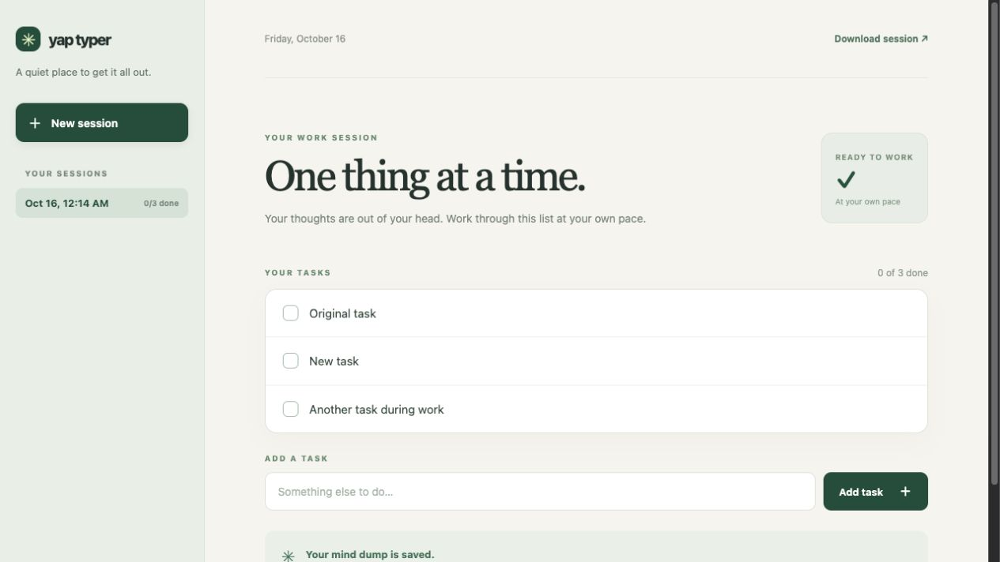

# Yap Typer

A small local app for a timed, write-only brain dump followed by a timed task list. It uses no external packages or accounts.



## Run it

Install [Node.js 20 or newer](https://nodejs.org/) if needed. In this folder, run:

```sh
npm start
```

Open <http://127.0.0.1:4173> in your browser. Keep the terminal open while using the app. You can also set `PORT` to choose another port.

## How it works

1. Start a session and choose the two timer lengths (default: 2 minutes and 1 minute).
2. The brain dump timer starts with your first character. Deleting, replacing, cutting, and undoing are blocked. The task list stays locked until the dump timer ends.
3. The task list timer starts when you begin writing. Put one task on each line. You can edit the list during its timer, or finish it early.
4. When the list timer ends, the checklist opens. Check and uncheck tasks, and add new ones as they come up during your work session.

Sessions are saved in the `data/` folder as one readable JSON file per session. The brain dump is in `dumpText`, and checklist items are in `tasks`. You can also download a session from the app. Set `YAP_TYPER_DATA_DIR` to save session files elsewhere.

The server listens only on `127.0.0.1`, so the app is for use on the computer where it is running.

## License

MIT. See [LICENSE](LICENSE).
